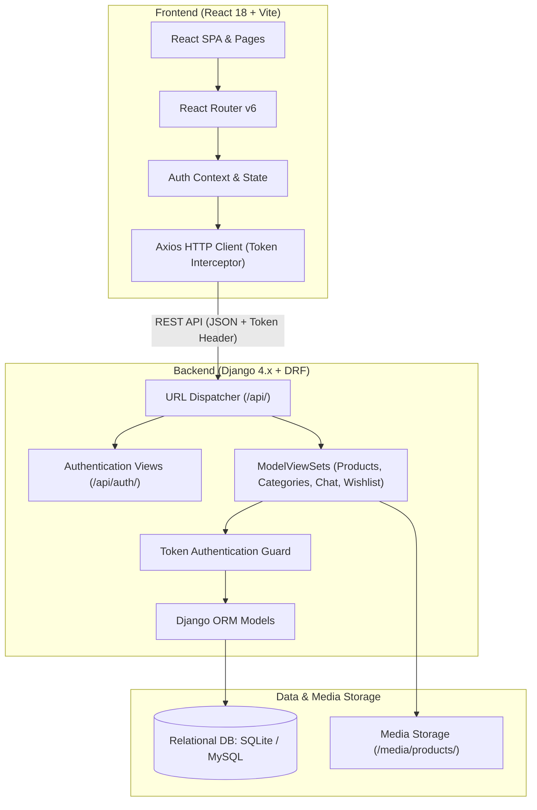

# 🛍️ ReSell — Modern Classifieds & Peer-to-Peer Marketplace

[](https://reactjs.org/)
[](https://vitejs.dev/)
[](https://www.python.org/)
[](https://www.djangoproject.com/)
[](https://www.django-rest-framework.org/)
[](https://www.framer.com/motion/)
[](LICENSE)

**ReSell** is a production-ready, full-stack peer-to-peer classifieds platform built with **Django REST Framework** and **React (Vite)**. Designed with enterprise UI/UX standards, fluid Framer Motion animations, real-time in-app buyer-seller chat, dynamic listing categorization, and dual-identifier authentication (username or mobile number).

---

## 📑 Table of Contents

- [Key Features](#-key-features)
- [System Architecture](#-system-architecture)
- [Tech Stack](#-tech-stack)
- [Project Directory Layout](#-project-directory-layout)
- [Getting Started](#-getting-started)
  - [Prerequisites](#prerequisites)
  - [Backend Setup](#backend-setup)
  - [Frontend Setup](#frontend-setup)
- [Environment Configuration](#-environment-configuration)
- [REST API Reference](#-rest-api-reference)
- [Architecture & Design Decisions](#-architecture--design-decisions)
- [Testing & Quality Assurance](#-testing--quality-assurance)
- [Contributing](#-contributing)
- [License](#-license)

---

## ✨ Key Features

### 🎨 Modern, Responsive User Interface
- **Polished SaaS Aesthetics**: Crafted with modern CSS styling, typography, and Feather SVG iconography (`react-icons/fi`).
- **Fluid Micro-Interactions**: Smooth card hover elevations, stagger entrance transitions, and modal animations powered by **Framer Motion**.
- **Intuitive Navigation**: Persistent header with dynamic search, quick action pills, location indicators, and mobile-friendly drawer menu alex_trader pass- alex12345.
- **Scroll Restoration**: Automatic viewport scroll restoration ensuring users land directly at the top when navigating across pages or opening listing details.

### 🏷️ Smart Catalog & Dynamic Categories
- **Pre-Seeded Taxonomies**: Curated categories covering Electronics, Vehicles, Real Estate, Fashion, Home & Furniture, Jobs, and Books.
- **On-the-Fly Custom Categories**: When listing an item, if a user's category isn't in the preset list, selecting **"Other (Specify Below)"** prompts an animated custom input that dynamically registers and assigns the new category.
- **Curated Multi-Image Galleries**: Rich product image galleries with high-resolution thumbnails, fallback image handlers, and condition badges (New, Like New, Good, Fair).

### 🔐 Dual-Identifier Authentication
- **Flexible Sign-In**: Users can sign in using either their **Username** or their registered **Mobile Phone Number** alongside their password.
- **Direct Registration**: Frictionless user onboarding with clean form validation and optional phone number assignment for buyer/seller direct contact.
- **Browser Autocomplete**: Standardized input fields with full browser credential manager and password autofill integration.

### 💬 Direct Buyer-Seller Messaging
- **Conversation Threads**: Prospective buyers can initiate direct chat threads with sellers right from any listing page.
- **Real-Time Indicators**: Live unread message counters in the header and quick message dropdown previews.
- **Context-Aware Inquiries**: Conversations link directly to the target product listing with instant pricing and thumbnail reference.

### 🔍 Search, Filter & Discovery
- **Full-Text Search**: Live keyword search across product titles and detailed descriptions.
- **Multi-Facet Filtering**: Filter by category, price ranges (min/max), product condition, and publication recency.
- **Sorting Options**: Sort by newest listings, price ascending, or price descending.
- **Wishlist & Bookmarks**: Save listings to a personal wishlist with instantaneous state toggling and persistent storage.

### 📦 Seller Management Dashboard
- **My Listings Hub**: Dedicated dashboard for sellers to monitor all their active advertisements.
- **Lifecycle Status Management**: Instantly toggle listings between **Available** and **Sold**.
- **Edit & Delete Controls**: Full editing capabilities for pricing, descriptions, images, and categories with strict owner-only access controls.

---

## 🏗️ System Architecture



---

## 🛠️ Tech Stack

| Layer | Technologies |
|---|---|
| **Frontend Framework** | [React 18](https://reactjs.org/) with [Vite 5](https://vitejs.dev/) |
| **Routing & State** | [React Router v6](https://reactrouter.com/), React Context API |
| **Animations & UI** | [Framer Motion](https://www.framer.com/motion/), [React Icons (Feather)](https://react-icons.github.io/react-icons/) |
| **HTTP Client** | [Axios](https://axios-http.com/) with request/response interceptors |
| **Backend Framework** | [Django 4.x](https://www.djangoproject.com/) & [Django REST Framework](https://www.django-rest-framework.org/) |
| **Database** | [SQLite](https://www.sqlite.org/) (Development default) / [MySQL 8.0+](https://www.mysql.com/) / [PostgreSQL](https://www.postgresql.org/) |
| **Image Processing** | [Pillow (PIL)](https://python-pillow.org/) |
| **Cross-Origin Handling**| [django-cors-headers](https://github.com/adamchainz/django-cors-headers) |
| **API Authentication** | DRF Token Authentication (`rest_framework.authtoken`) |

---

## 📂 Project Directory Layout

```text
ReSell/
├── backend/                       # Django Backend Root
│   ├── manage.py                  # Django administrative script
│   ├── requirements.txt           # Python backend dependencies
│   ├── olx/                       # Core Django project configuration
│   │   ├── settings.py            # Global settings, apps, & database configs
│   │   ├── urls.py                # Main URL router & API endpoints
│   │   └── wsgi.py                # WSGI entrypoint
│   ├── accounts/                  # User management & authentication app
│   │   ├── models.py              # Profile & custom user metadata
│   │   ├── serializers.py         # Registration & user serializers
│   │   └── views.py               # Account views
│   ├── product/                   # Marketplace business logic
│   │   ├── models.py              # Product, Category, Brand, Chat, Wishlist
│   │   ├── serializers.py         # DRF serializers (includes dynamic category support)
│   │   ├── views.py               # ViewSets & dual-identifier login endpoints
│   │   ├── urls.py                # API router configuration
│   │   └── management/commands/   # Custom commands (seed_data.py)
│   └── media/                     # Uploaded listing photos & static assets
│
├── frontend/                      # React SPA (Vite)
│   ├── package.json               # Frontend dependencies & scripts
│   ├── vite.config.js             # Vite bundler configuration
│   ├── index.html                 # Single page application entry HTML
│   ├── .env                       # Frontend environment variables
│   └── src/
│       ├── components/            # Reusable components (Header, Footer, ProductCard, etc.)
│       ├── context/               # AuthContext & global state providers
│       ├── pages/                 # Route views (Home, ProductDetail, CreateListing, etc.)
│       ├── services/              # Axios instance & API service layer
│       ├── App.jsx                # Router setup & layout wrappers
│       ├── index.css              # Global styles, variables, & resets
│       └── main.jsx               # React DOM entry point
│
├── .env                           # Backend environment variables
├── .gitignore                     # Git ignore rules
└── README.md                      # Project documentation
```

---

## 🚀 Getting Started

Follow the steps below to clone, configure, and launch the platform locally.

### Prerequisites

Ensure you have the following installed on your machine:
- **Python**: version 3.10 or higher
- **Node.js**: version 18.x or 20.x (`nvm` recommended)
- **Git**
- Optional: **MySQL 8.0+** (if running with MySQL instead of default SQLite)

---

### Backend Setup

1. **Clone the repository:**
   ```bash
   git clone https://github.com/your-username/ReSell.git
   cd ReSell
   ```

2. **Navigate to the backend directory:**
   ```bash
   cd backend
   ```

3. **Create and activate a Python virtual environment:**
   ```bash
   # On Linux / macOS
   python3 -m venv venv
   source venv/bin/activate

   # On Windows
   python -m venv venv
   venv\Scripts\activate
   ```

4. **Install backend dependencies:**
   ```bash
   pip install --upgrade pip
   pip install -r requirements.txt
   ```

5. **Initialize database migrations:**
   ```bash
   python3 manage.py migrate
   ```

6. **Seed the sample marketplace catalog (Categories, Brands, & Listings):**
   ```bash
   python3 manage.py seed_data
   ```

7. **Create your administrative superuser:**
   ```bash
   python3 manage.py createsuperuser
   ```
   > [!NOTE]
   > Follow the terminal prompt instructions to set your preferred administrative username, email, and password.

8. **Start the Django development server:**
   ```bash
   python3 manage.py runserver
   ```
   The backend API will be available at `http://localhost:8000/`.

---

### Frontend Setup

1. **Open a new terminal session and navigate to the frontend folder:**
   ```bash
   cd ReSell/frontend
   ```

2. **Install frontend dependencies:**
   ```bash
   npm install
   ```

3. **Verify the environment configuration:**
   Ensure `frontend/.env` points to your backend URL:
   ```env
   VITE_API_URL=http://localhost:8000
   ```

4. **Start the Vite development server:**
   ```bash
   npm run dev
   ```
   The application will be live at `http://localhost:5173/`.

5. **(Optional) Build for production:**
   ```bash
   npm run build
   ```

---

## ⚙️ Environment Configuration

### Backend Environment Variables (`.env`)

Place a `.env` file in the root directory (or configure system environment variables):

| Variable | Default Value | Description |
|---|---|---|
| `DJANGO_SECRET_KEY` | *(auto-generated)* | Unique cryptographic salt for Django security |
| `DJANGO_DEBUG` | `True` | Debug mode (`True` for development, `False` for production) |
| `DJANGO_ALLOWED_HOSTS`| `localhost,127.0.0.1` | Comma-separated list of permitted host/domain names |
| `DB_ENGINE` | `django.db.backends.sqlite3` | Database backend engine (`sqlite3`, `mysql`, `postgresql`) |
| `DB_NAME` | `db.sqlite3` | Database name or file path |
| `DB_USER` | `""` | Database username (for MySQL/Postgres) |
| `DB_PASSWORD` | `""` | Database password (for MySQL/Postgres) |
| `DB_HOST` | `""` | Database host (e.g. `localhost` or `127.0.0.1`) |
| `DB_PORT` | `""` | Database port (e.g. `3306` for MySQL, `5432` for Postgres) |
| `CORS_ALLOWED_ORIGINS`| `http://localhost:5173,...` | Whitelisted frontend origins allowed for cross-origin requests |

### Frontend Environment Variables (`frontend/.env`)

| Variable | Default Value | Description |
|---|---|---|
| `VITE_API_URL` | `http://localhost:8000` | Base URL of the running Django backend API |

---

## 📡 REST API Reference

The backend exposes a comprehensive RESTful API under the `/api/` prefix.

### 🔐 Authentication Endpoints

| Method | Endpoint | Auth Required | Description |
|---|---|:---:|---|
| `POST` | `/api/auth/register/` | No | Register a new user account with username, email, password, and optional mobile number |
| `POST` | `/api/auth/login/` | No | Authenticate via **Username OR Mobile Number** + Password; returns auth token & user profile |
| `POST` | `/api/auth/logout/` | Yes | Invalidate and purge the active session token |
| `GET` | `/api/auth/user/` | Yes | Retrieve profile details of the currently authenticated user |
| `POST` | `/api/auth/send-otp/` | No | Optional carrier SMS gateway OTP dispatcher endpoint |
| `POST` | `/api/auth/verify-otp/` | No | Optional carrier SMS OTP verification endpoint |

### 📦 Products & Listings

| Method | Endpoint | Auth Required | Description |
|---|---|:---:|---|
| `GET` | `/api/products/` | No | List products with pagination, search (`?search=`), category filter (`?category=`), and sorting |
| `POST` | `/api/products/` | Yes | Create a new listing with image upload and dynamic custom category support (`other_category`) |
| `GET` | `/api/products/{slug}/` | No | Retrieve detailed view of a specific listing |
| `PUT / PATCH` | `/api/products/{slug}/` | Yes (Owner) | Update an existing listing's details, category, or status |
| `DELETE` | `/api/products/{slug}/` | Yes (Owner) | Permanently delete a listing |
| `GET` | `/api/products/my_listings/` | Yes | Retrieve all active and sold listings created by the logged-in user |

### 🏷️ Categories & Brands

| Method | Endpoint | Auth Required | Description |
|---|---|:---:|---|
| `GET` | `/api/categories/` | No | Retrieve all marketplace categories with icons and product counts |
| `GET` | `/api/categories/{slug}/` | No | Retrieve individual category details and associated listings |
| `GET` | `/api/brands/` | No | Retrieve list of verified manufacturer brands |

### 💬 Messaging & Inquiries

| Method | Endpoint | Auth Required | Description |
|---|---|:---:|---|
| `GET` | `/api/conversations/` | Yes | List all conversation threads for the current user |
| `POST` | `/api/conversations/` | Yes | Start or retrieve a conversation thread for a specific listing |
| `GET` | `/api/conversations/{id}/` | Yes | Get message history for a conversation |
| `POST` | `/api/conversations/{id}/send_message/` | Yes | Send a message in a conversation thread |

### 🤍 Wishlist

| Method | Endpoint | Auth Required | Description |
|---|---|:---:|---|
| `GET` | `/api/wishlist/` | Yes | List all products saved to the user's wishlist |
| `POST` | `/api/wishlist/toggle/` | Yes | Toggle bookmark status for a product (adds if absent, removes if present) |

---

## 💡 Architecture & Design Decisions

### 1. Dual-Identifier Authentication Strategy
Rather than restricting sign-in to just usernames or emails, the login resolver intercepts the incoming identifier, inspecting whether it matches an existing user's phone number or username:
```python
# Resolves user via either identifier cleanly:
user_obj = User.objects.filter(
    Q(username__iexact=identifier) |
    Q(profile__phone_number=identifier)
).first()
```

### 2. Extensible Dynamic Categorization
Marketplaces often suffer when user items do not fit into pre-defined taxonomies. ReSell allows users to select `"Other (Specify Below)"`. The backend serializer dynamically provisions the newly typed category, creates a clean URL slug, and assigns the product immediately.

### 3. Automatic Viewport Scroll Restoration
Single Page Applications (SPAs) frequently maintain scroll positions across client routes, causing product details to open mid-page or at the bottom. ReSell enforces top-of-page scroll restoration via a global `<ScrollToTop />` component and explicit scroll-to-top hooks upon listing selection.

### 4. Stateless Token Security
The frontend stores authentication tokens securely in local storage, and Axios interceptors automatically attach the `Authorization: Token <token>` header to all outgoing requests. Invalid or expired tokens trigger an automatic interceptor redirect back to login.

---

## 🧪 Testing & Quality Assurance

### Run Backend Unit & Integration Tests:
```bash
cd backend
source venv/bin/activate
python3 manage.py test
```

### Run Frontend Linting & Production Build Validation:
```bash
cd frontend
npm run build
```

---

## 🤝 Contributing

Contributions are welcome! To contribute:

1. **Fork the Repository**
2. **Create a Feature Branch**:
   ```bash
   git checkout -b feature/awesome-enhancement
   ```
3. **Commit Your Changes**:
   ```bash
   git commit -m "feat: Add awesome enhancement"
   ```
4. **Push to Your Branch**:
   ```bash
   git push origin feature/awesome-enhancement
   ```
5. **Open a Pull Request**

---

## 📄 License

This project is licensed under the **MIT License**. See the [LICENSE](LICENSE) file for more information.

---

<p align="center">
  <b>ReSell Platform</b> &bull; Built with Django REST Framework & React
</p>

## 🤝 Contributing

Contributions are welcome! To contribute:

1. **Fork the Repository**
2. **Create a Feature Branch**:
   ```bash
   git checkout -b feature/awesome-enhancement
   ```
3. **Commit Your Changes**:
   ```bash
   git commit -m "feat: Add awesome enhancement"
   ```
4. **Push to Your Branch**:
   ```bash
   git push origin feature/awesome-enhancement
   ```
5. **Open a Pull Request**

---

## 📄 License

This project is licensed under the **MIT License**. See the [LICENSE](LICENSE) file for more information.

---

<p align="center">
  <b>ReSell Platform</b> &bull; Built with Django REST Framework & React
</p>

